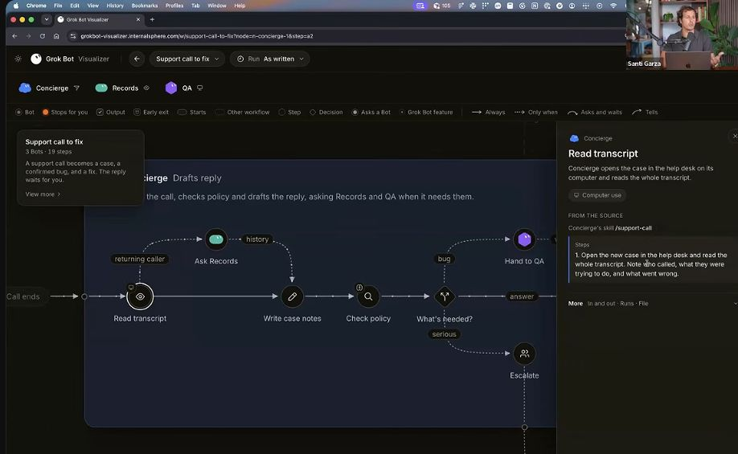
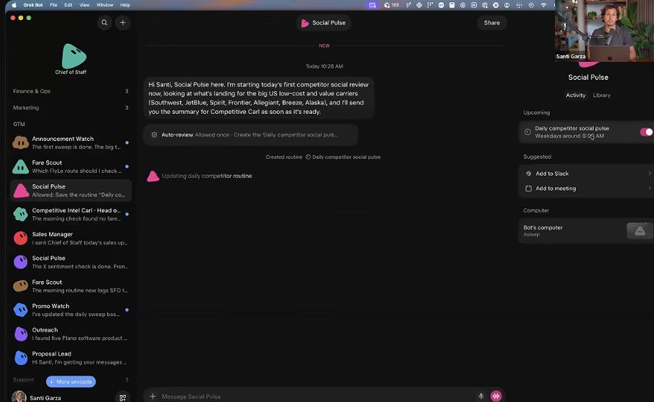
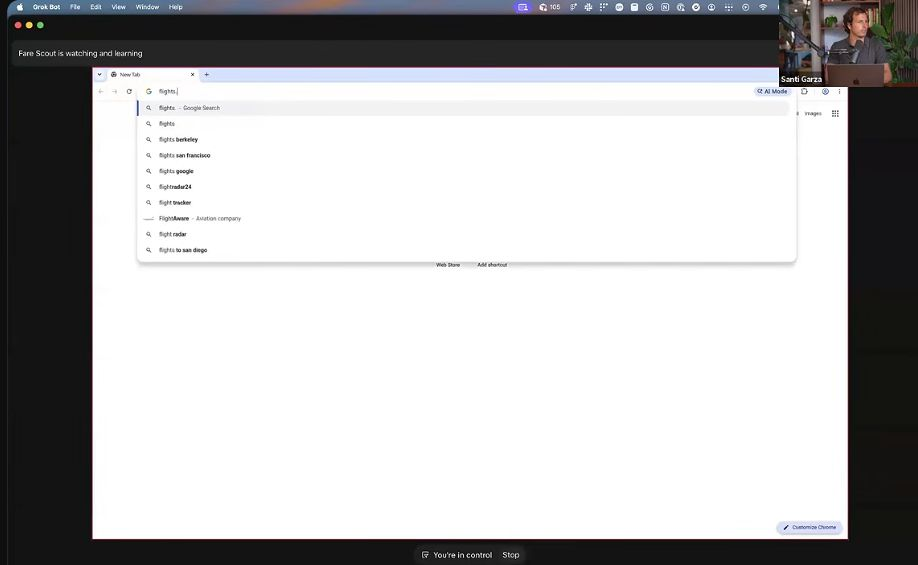
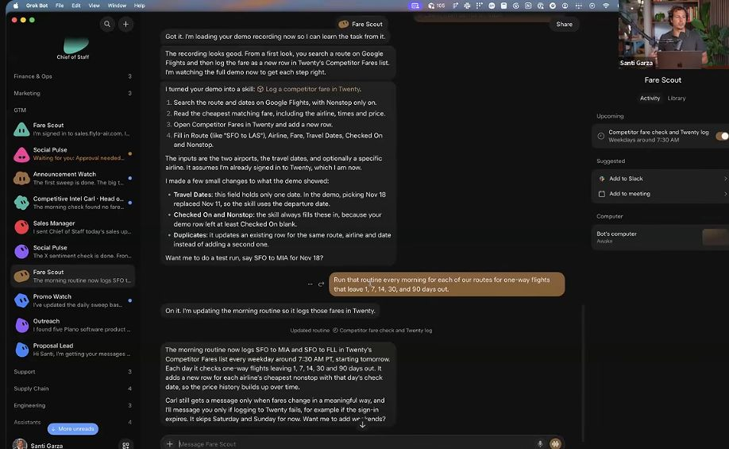
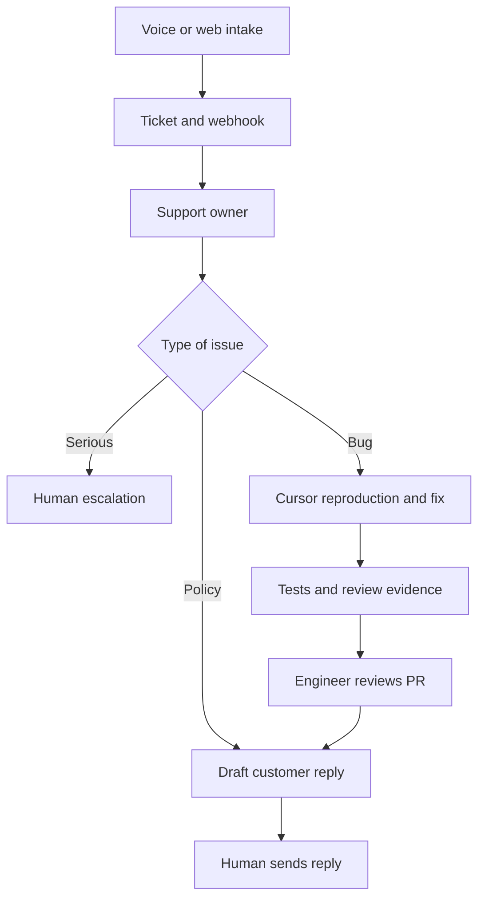
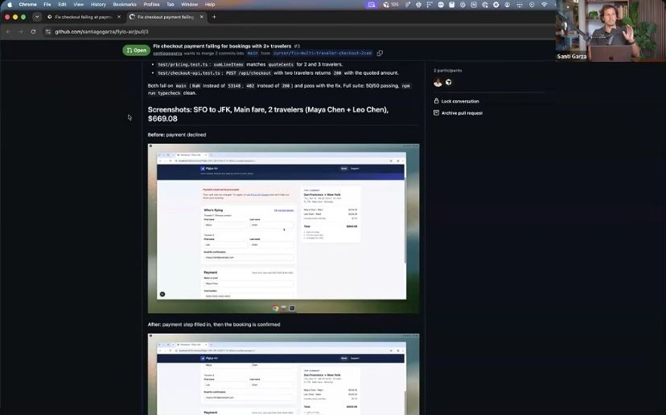

This workshop teaches how to give persistent AI bots clear jobs, access to real tools, recurring responsibilities, and explicit points where a human takes over. The central shift is from answering questions to owning a workflow: gather evidence, do the preparation, hand off specialist work, and return a result that is ready to review.

**Source:** [Grok Bot for Enterprise Teams by Santi Garza and Anahita Sahu](https://www.youtube.com/watch?v=jcKcAfJtTlk), published October 29, 2026, duration 55:15. Santi leads the demonstrations; Anahita moderates and answers questions. The fictional airline is **FlyLo Air**. Automatic captions render its name and Grok Bot inconsistently; recognizable product names are normalized here.

**Coverage:** The available transcript was read from the opening at 00:02 through the final spoken farewell at 55:08. Screenshots sample important demonstrations rather than every frame. This is a comprehensive paraphrased teaching replacement for the substantive discussion, not a word-for-word transcript or a guarantee that every on-screen detail has been recovered. “Workshop” identifies what the presenters show or say; “Added explanation” identifies extensions, specifications, or current documentation.

# Executive summary

**Choose a job before choosing a bot.** Ask which person you would hire to remove a recurring bottleneck. Give the bot a narrow outcome, current sources, access, an output format, and a stopping rule. Start with one useful workflow; add specialists when their responsibilities remain distinct.

**Build a small reporting structure.** The competitive-intelligence demonstration starts with one analyst, then creates fare, social, and announcement specialists reporting to a director. The director consolidates evidence and raises decisions; it should reduce your attention burden rather than merely relay every message.

**Teach the method, then schedule it.** Record a browser workflow on the bot’s computer, review the method it infers, test a fresh example, and approve a recurring routine. In the airline example, a daily fare scan covers departures 1, 7, 14, 30, and 90 days away; the human receives a weekly synthesis unless something urgent happens.

**Separate preparation from consequential action.** The support workflow can gather history, check policy, reproduce a bug, prepare a fix, and draft a customer reply. The human still reviews the reply and the engineer reviews the pull request. Those are explicit workflow boundaries.

**Use evidence to earn autonomy.** Inspect outputs closely at first, correct persistent instructions, and reduce checking only after repeated successful runs. For engineering, require a reproduced failure, a test that fails before the fix and passes afterward, and reviewable code. A convincing explanation alone does not establish success.

**For your own work:** the transferable idea is a persistent tutorial-production owner that receives a video, checks source coverage, prepares teaching material, verifies claims, and returns a finished review package. You can adopt the operating pattern without building a large bot organization.

# Video map and evidence guide

| Video interval | What is covered | Nature of the material |
| --- | --- | --- |
| [00:00 to 01:53](https://www.youtube.com/watch?v=jcKcAfJtTlk&t=0s) | Introductions, audience, Q&A logistics | Workshop framing |
| [01:53 to 07:13](https://www.youtube.com/watch?v=jcKcAfJtTlk&t=113s) | Chat, agents, persistent teammates; Grok, Grok Bot, Cursor, API; voice notes | Product overview |
| [07:13 to 17:04](https://www.youtube.com/watch?v=jcKcAfJtTlk&t=433s) | Hiring analogy; support, inventory, prospecting workflows | Internal visualizer and conceptual examples |
| [17:04 to 25:23](https://www.youtube.com/watch?v=jcKcAfJtTlk&t=1024s) | Create analyst; expand role; create three reports; approve routine | Product demonstration |
| [25:23 to 34:42](https://www.youtube.com/watch?v=jcKcAfJtTlk&t=1523s) | Shared computer; teach fare lookup; credentials; schedule; director reporting | Live demonstration plus a previously prepared example |
| [34:42 to 43:57](https://www.youtube.com/watch?v=jcKcAfJtTlk&t=2082s) | Voice intake, form, webhook, support bot, Cursor agent, prior PR, review gates | Live intake and agent launch; earlier completed fix |
| [43:57 to 47:19](https://www.youtube.com/watch?v=jcKcAfJtTlk&t=2637s) | Sales apps and five sales patterns | Connector screen, suggestions, personal anecdote |
| [47:19 to 55:15](https://www.youtube.com/watch?v=jcKcAfJtTlk&t=2839s) | Specialization, memory, parallel work, sharing, templates, Hagglebot, SDK, onboarding | Q&A and product navigation |

The animated workflow visualizer is an **internal teaching application**, not the shipping Grok Bot interface. The presenters explicitly clarify this near both the beginning and end. Santi says his brother Lucas built it and suggests asking a bot to build a similar view of your own workflows. Do not assume the product contains that organization chart or that a drawn edge enforces a permission.

The voice example produces a live ticket and starts an agent. The completed PR then shown was prepared earlier. This proves less than watching the newly initiated run finish end to end, but it still explains the intended architecture clearly.

# From chat to persistent teammates

At [01:53](https://www.youtube.com/watch?v=jcKcAfJtTlk&t=113s), Santi describes three stages. Chat supplies answers. An agent can act, such as editing files or building a site. A persistent teammate has a recognizable role, accumulated context, and recurring work that can continue while you are away. The key difference is durable ownership, not simply a more elaborate prompt.

| Product | Role in the workshop | Example |
| --- | --- | --- |
| Grok | Underlying conversational and reasoning model, with X-related research capabilities | Analyze customer sentiment |
| Grok Bot | Application for persistent delegation across apps and websites | Own competitive intelligence |
| Cursor | Engineering platform and cloud coding agents | Reproduce and fix checkout |
| Grok API | Programmatic model capabilities inside another application | Voice support intake; image and video capabilities are also mentioned |

Santi mentions Grok 4.6 and 4.7, the acquisition of Cursor, favorable pricing, and strong voice benchmark standing. These are part of his product framing; this tutorial does not use them as evidence that the workflows outperform alternatives. No controlled comparison, price analysis, or named voice leaderboard is presented in this segment.

The bot interface has a roster on the left, persistent conversation in the middle, and activity, routines, and computer access on the right. Names and job descriptions help the human know where to find work later.

Anahita also says bots can leave voice notes and that their voice can be changed. That is distinct from the customer-facing voice API demonstration later. The workshop does not provide a complete voice-settings walkthrough.

# Choose jobs by recurring outcomes

At [07:13](https://www.youtube.com/watch?v=jcKcAfJtTlk&t=433s), the starting question is who you would hire first. An assistant is a common answer because email, Slack, schedules, and product changes consume attention. The next role depends on the bottleneck.

| Area | Work the presenters suggest delegating |
| --- | --- |
| Personal coordination | Organize messages and schedule; prepare work before you open your inbox |
| Engineering and product | Releases, QA, testing, bug reproduction |
| Sales | Prospect research, drafts, follow-ups, call preparation, tracking promises |
| IT and support | Intake, ticket investigation, policy checks, escalation |
| Operations | Low-stock detection, inbound inventory checks, supplier order preparation |
| Marketing | Competitor prices, sentiment, launches, loyalty changes |

The point is to assign ownership of an outcome, not ask for generic assistance. “Watch competitors” leaves the bot to guess scope and success. “Check these routes, compare like-for-like fares, record dated evidence, and escalate material changes” makes the work inspectable.

**Added explanation:** A useful first job has repeated inputs, a recognizable finished output, accessible evidence, and a review point. Choose a task whose result you can assess quickly. A routine that saves twenty minutes but creates thirty minutes of checking has not reduced your workload.

# Three workflow patterns from the visualizer

## Support call to case resolution

At [09:47](https://www.youtube.com/watch?v=jcKcAfJtTlk&t=587s), three roles divide the work: Concierge owns the case, Records supplies history, and QA investigates a possible product defect.

1. After a call, Concierge opens the help-desk case and reads the full transcript. It identifies the caller, intended action, and failure.

2. For a returning caller, Records retrieves prior cases, promises, and contact preferences. A first-time caller skips that history step.

3. Concierge writes case notes and checks the relevant policy.

4. If policy answers the question, it drafts a reply. If the issue looks like a bug, it requests QA reproduction. Serious issues, such as a wrongful charge or danger, escalate immediately.

5. The configured workflow waits for a human to send the customer reply.

6. After the reply, Concierge closes the case and updates Records so future cases can use the outcome.

The presenter notes that low-risk workflows can permit more autonomous communication. The demonstrated pattern deliberately retains a human at the customer-message boundary.



*Workshop screenshot at approximately 11:34. Follow the branches: returning-caller history, suspected bug to QA, ordinary answer, and serious escalation. This is the internal visualizer.*

## Low stock to supplier order

At [14:05](https://www.youtube.com/watch?v=jcKcAfJtTlk&t=845s), Planner watches inventory and identifies a reorder need. Storekeeper checks parts already inbound through the operations system. Purchaser prepares the supplier order for approval. Checking inbound stock before ordering prevents the simplest duplicate-order mistake.

**Added explanation:** A practical policy could use inventory position equal to on-hand stock plus inbound stock minus allocated demand. Reorder when that position falls below the chosen threshold. The video does not specify that formula, thresholds, or purchasing rules; those must come from the business.

## Prospecting with several human checkpoints

At [14:57](https://www.youtube.com/watch?v=jcKcAfJtTlk&t=897s), Prospector works in Salesforce to identify suitable companies and people, existing users, and timely reasons to reach out. It builds a prospecting sheet and stops for account selection, draft outreach, and sample review.

This illustrates a workflow with several approval points rather than a single approval at the end. Santi estimates that it could remove 90–95% of the time for that workflow, but no timed measurement or sample size is shown. Treat the percentage as a presenter estimate.

# Build the competitive intelligence team

## Create and expand the analyst

At [17:47](https://www.youtube.com/watch?v=jcKcAfJtTlk&t=1067s), Santi chooses the sidebar plus button, creates **Competitive Carl**, and selects a seasonal avatar. The bot initially offers possible jobs based on its name. He provides a custom brief assigning ownership of competitor fares, route announcements, changes, and recommended responses for FlyLo’s important routes.

He prefers a job description because it forces him to structure the work. He then adds loyalty-program changes. The role evolves through conversation, as a new colleague’s responsibilities might evolve.

**Adapted prompt based on the demonstration, not a verbatim quotation:**

```text
Act as FlyLo Air’s competitive intelligence analyst.
Monitor competitor fares and route announcements for our priority routes.
Explain what changed, link to the evidence, and identify a possible response.
Also include material loyalty-program changes.
Ask me for the route list and competitor list before assuming either.
```

The last sentence makes an implicit setup dependency explicit. The bot cannot meaningfully monitor “our top routes” without a current source for those routes.

## Promote the analyst and create specialists

At [20:11](https://www.youtube.com/watch?v=jcKcAfJtTlk&t=1211s), Santi asks Carl to become a director and create three reporting bots.

| Specialist | Inputs and responsibility | Output to the director |
| --- | --- | --- |
| Fare Scout | Comparable competitor flights | Fare observations and changes |
| Social Pulse | Competitor social posts, including X and LinkedIn | What appears to resonate with customers |
| Announcement Watch | Websites and promotional email | Route, promotion, and other important announcements |

Bots can have an email address for subscriptions. That lets a bot monitor incoming promotional mail instead of relying only on manual browsing.

**Adapted delegation prompt:**

```text
Coordinate competitive intelligence through three focused specialists:
one for comparable fares, one for daily competitor social activity,
and one for website and promotional-email announcements.
Have each specialist report to you with dated source links.
Resolve inconsistencies and send me the decisions that need my attention.
```

Santi recommends keeping roughly one to seven direct reports as a personal management heuristic. He does not establish it as a universal organizational law or optimal number of bots. The useful mechanism is consolidation: specialists preserve detail, the director reconciles it, and the human sees a manageable decision queue.

## Create and approve the routine

At [24:04](https://www.youtube.com/watch?v=jcKcAfJtTlk&t=1444s), Social Pulse requests permission to save a daily competitor-social routine. Santi inspects the proposal and allows it. The recurring task then appears in the bot’s routine area. He explains that a later message can change its cadence, for example to Mondays covering the preceding week.



*Workshop screenshot at approximately 24:48. The approval event and the newly scheduled routine are visible together. Saving a routine changes future behavior; inspect its task, timing, and scope.*

At [33:06](https://www.youtube.com/watch?v=jcKcAfJtTlk&t=1986s), Santi instructs the three specialists to report to Carl instead of contacting him directly. Carl should deliver a Monday-morning synthesis and escalate exceptional urgency.

**Added explanation:** Define “urgent” operationally. For example, a verified competitor launch on a priority route may merit an immediate alert; an ordinary social post may wait for the weekly report. Otherwise every specialist can invent a different escalation threshold.

# Teach Fare Scout by demonstration

At [25:23](https://www.youtube.com/watch?v=jcKcAfJtTlk&t=1523s), Santi shows the bot’s computer and uses **Teach a task**. The important architecture clarification follows: bots have separate screens, but the bots on one user account share a virtual computer, including files and signed-in sessions. Separate bot names do not imply separate machines.

The demonstration searches Google Flights for a one-way flight from San Francisco to Las Vegas about a week ahead, identifies the lowest fare, then enters the observation into the fictional airline’s internal **Twenty** tool. One search shows Frontier at $84; a later view shows $76. These are demonstration observations, not current fare quotes or a controlled price comparison.

The recording is interrupted when sign-in becomes awkward. Santi switches to secure login and then resumes. He also shows a recording and learned process prepared earlier. That matters: the segment combines an in-progress live attempt with a completed teaching example.



*Workshop screenshot at approximately 27:09. “Fare Scout is watching and learning” identifies teaching mode. The workflow is being demonstrated on the bot’s computer.*

The resulting skill recognizes the route and dates, selects the cheapest matching fare, opens Twenty’s Competitor Fares list, and fills the appropriate fields. The saved example also notes nonstop filtering, checked date, and duplicate handling.

He then broadens the task to the airline’s routes and departures **1, 7, 14, 30, and 90 days ahead**. The prepared routine runs on weekdays around **7:30 a.m.**, with the screenshot specifying Pacific time. Route lists should come from the source system, so new routes can enter the process without manually rewriting every navigation instruction.



*Workshop screenshot at approximately 31:54. Read the learned method and the schedule together: a reusable skill describes how; the routine determines when and over which inputs it runs.*

Santi contrasts this adaptability with a fixed script. **Added explanation:** Scripts can also be parameterized and robust; agents add judgment under variation, but that judgment must still be checked. One demonstration cannot establish behavior for sold-out flights, ties, stale sessions, changed layouts, mixed currencies, baggage differences, or absent results.

**Added fare observation contract:**

```json
{
  "route": "SFO-LAS",
  "departure_date": "YYYY-MM-DD",
  "trip_type": "one_way",
  "nonstop_required": true,
  "airline": "source airline",
  "fare": 76.00,
  "currency": "USD",
  "checked_at": "ISO timestamp with timezone",
  "source_url": "source evidence URL",
  "availability_status": "available",
  "notes": "fare class and material restrictions"
}
```

This is an illustrative schema, not a product API. Decide a row identity before automating writes. If the objective is daily price history, include observation date in the key and update only duplicate observations from the same run/day. If the objective is a current-price table, update the existing itinerary row. A retry should not silently double the data.

**Documentation addition:** A skill records the reusable method; a routine supplies a schedule or event trigger. Teaching currently records visible computer interaction for up to ten minutes without microphone audio, and availability may vary by account. Review the inferred skill and test a safe example before scheduling it. [Official skills and routines documentation](https://docs.x.ai/grok-bot/skills-routines-and-automations).

# Credentials and the shared computer

At [28:25](https://www.youtube.com/watch?v=jcKcAfJtTlk&t=1705s), Santi asks the bot to sign into the internal sales site. He explains that passwords belong in a secure sign-in flow or password manager, not ordinary chat. A login made through another bot is available because the account shares the computer.

Once signed in, he opens the computer and confirms the application is accessible. He can take control at any time. “Sign in once” reduces repetitive setup, although sessions can expire or require verification later.

**Documentation addition:** The persistent computer shares files, browser cookies, signed-in sessions, and command-line credentials across your bots; each bot has a separate screen. This enables parallel browser work, but the screens are not security boundaries. Apps provide structured access where available; browser interaction covers visual workflows or services lacking a suitable app. [Official computer and apps documentation](https://docs.x.ai/grok-bot/computer-and-apps).

**Documentation addition:** Vault holds logins, cards, and contact information. Saved passwords, card numbers, and security codes are filled without exposing those values to the model. Vault is account-wide rather than limited to a single bot; it is not supported on shared bots, which use their Secrets setup. API keys belong in the secure secret flow. [Official Vault documentation](https://docs.x.ai/grok-bot/vault).

**Practical implication:** Use a bot’s role to organize work; use account permissions and product controls to limit access. Giving one bot a narrow job does not create a separate permission sandbox for it.

# Support intake to a reviewable code fix

## What happens live

At [35:30](https://www.youtube.com/watch?v=jcKcAfJtTlk&t=2130s), Santi calls the fictional airline’s support system. He reports that checkout fails at payment. The voice system asks for the booking reference and reservation email, then populates a visible form. The caller can correct the information before pressing Submit.

The form provides a useful observation point: structured data becomes visible rather than remaining buried in audio. The video description also says the voice demo switches to Spanish; that exchange is not represented in the available English transcript, so its exact wording is not reconstructed here. Current voice documentation supports Spanish variants, which establishes capability but does not verify the exact exchange. [Official voice documentation](https://docs.x.ai/developers/model-capabilities/audio/speech-to-speech).

After submission, a **webhook** starts the support bot. A webhook is an event notification sent to another system, typically an HTTP request containing structured data. Here it bridges ticket creation and agent work. The presenter says a real deployment could initiate on call completion rather than using the visible demo submit button.

## What the support bot hands to Cursor

At [39:25](https://www.youtube.com/watch?v=jcKcAfJtTlk&t=2365s), the support bot has created a ticket describing the checkout failure and launches a Cursor Cloud Agent. The requested engineering work is to reproduce the problem, fix the cause, add a test, and open a PR with before-and-after screenshots.

The bot monitors the coding agent’s trace. At [41:16](https://www.youtube.com/watch?v=jcKcAfJtTlk&t=2476s), Santi points out a subagent reproducing the bug. This is the larger pattern: a general workflow owner delegates implementation to an engineering environment instead of requiring the human to copy and paste the issue between tools.

**Added architecture diagram:**



The diagram separates customer approval from engineering approval. A PR is a proposed change for review; opening one does not mean it has been merged, deployed, or proven correct.

**Added interactive explanation:** choose a policy question, checkout bug, or serious incident, then advance through the handoffs. Toggle returning caller to see why prior history changes the path. This is a teaching model, not a live connection to any support system.


**Documentation addition:** Cursor Cloud Agents run in isolated development VMs with repositories, dependencies, commands, and tool access. Their ability to verify a fix depends on a working environment. A bot that can edit code but cannot reproduce the application or run meaningful tests cannot establish that the defect is fixed. [Official Cloud Agents documentation](https://cursor.com/docs/cloud-agent).

## What the earlier completed run shows

At [41:40](https://www.youtube.com/watch?v=jcKcAfJtTlk&t=2500s), Santi explicitly switches to an earlier completed PR. It includes reproduction steps, a screenshot of the failed payment, a failing regression test, the fix, and an after screenshot.

The recorded support-bot explanation and code view identify an arithmetic problem involving multi-traveler bookings: ticket prices were being combined incorrectly, causing a bad total and payment failure. The teaching value is the causal chain from a customer symptom to a reproducible condition and then to a test. The exact implementation is not reconstructed as repository-ready code.

The PR evidence can be revisited at [42:07 to 42:32](https://www.youtube.com/watch?v=jcKcAfJtTlk&t=2527s). Tests and a readable diff provide stronger evidence than a success screenshot alone.



*Earlier completed PR at approximately 42:01. The review package includes regression-test results and before-and-after checkout images.*

At [42:51](https://www.youtube.com/watch?v=jcKcAfJtTlk&t=2571s), Santi describes additional gates: Bugbot review and autofix, a security reviewer, an approval agent, and monitoring the change through production logs. These are described as available layers, not all demonstrated to completion.

**Documentation addition:** Bugbot reviews PR changes and can launch a Cloud Agent to address findings. A required review status alone may not block unresolved findings: the documented default for findings is a neutral status unless failure-on-unresolved behavior is enabled. Review policy must match the intended merge gate. [Official Bugbot documentation](https://prod.cursor.com/docs/bugbot).

## A concrete handoff you can reuse

**Added specification, adapted to the workshop:**

```text
Input: ticket ID, sanitized issue description, reproduction context,
affected application and permitted test environment.

Reproduce the reported failure. Record exact steps and observations.
Add a regression test that fails on the original code for the intended reason.
Make the smallest justified fix. Run the new test and relevant existing checks.
Open a PR with the cause, change, test results, and before/after evidence.
If reproduction fails, report that outcome and the missing information.
Stop before merge or deployment. Draft the customer update for review.
```

A regression test preserves behavior that must keep working after a change. For this checkout example, meaningful cases include two and three travelers, the one-traveler path, and agreement between displayed and validated totals. “The test passed” is informative only if the test checks the intended behavior and was shown to catch the original defect.

# Sales workflows and connected apps

At [43:57](https://www.youtube.com/watch?v=jcKcAfJtTlk&t=2637s), Santi shifts from cost savings to revenue workflows. Much of a seller’s work occurs around the actual sales conversation: account research, Salesforce updates, follow-ups, call preparation, and finding context scattered across Slack and Gong.

He opens **Connect apps**, filters for sales, and highlights **Granola**, **Clay**, and **Gong**, alongside custom connector support. Granola supplies meeting notes and transcripts; Gong supplies recorded-call context; Clay is part of the prospecting and account-research toolset discussed. Access must be configured; a listed integration is not evidence that a particular account is authenticated.

| Sales pattern | Inputs | Useful finished output | Human decision |
| --- | --- | --- | --- |
| Find leads | Funding, job posts, leadership changes, buying signals | Researched target list for each rep | Which accounts deserve attention |
| Write first touch | Account evidence and context | Personalized draft outreach | Review and send |
| Prepare calls | Prior calls, customer questions, current information | Briefing and relevant demonstration | How to conduct the meeting |
| Keep deals moving | Opportunities, promised next steps, champion activity | Stalled-deal flags and proposed nudge | Whether and how to follow up |
| Morning audio briefing | Customer and deal updates | Short spoken briefing | What to prioritize |

Santi’s personal anecdote is stronger than a generic summary workflow: before an unexpected customer meeting, his bot reportedly researched earlier calls, anticipated questions, prepared a one-pager, built a customer-specific demo, and tested it on its computer. This is his account of a prior event, not a full live demonstration in the workshop.

He also suggests a two-minute morning podcast about customers. The broader lesson is to deliver the right preparation in the format that fits the person’s work, rather than generating another long report to read.

**Added explanation:** Link every personalized outreach claim to a dated source. Treat a buying signal as a hypothesis about relevance, not proof that a person wants a sales message.

# Specialization memory and parallel work

The Q&A begins at [47:19](https://www.youtube.com/watch?v=jcKcAfJtTlk&t=2839s). Why have several bots rather than one doing everything? Santi gives three reasons.

**Focus:** A specialized role accumulates relevant context and long-term memory around a stable job. **Human navigation:** the user can open Social Pulse to find sentiment work instead of searching a sprawling mixed conversation. **Parallelism:** multiple bots can work on their own responsibilities at the same time; Santi gives a Monday-morning example involving many active bots.

The workshop distinguishes short-term and long-term memory conversationally; it does not disclose retrieval algorithms, storage formats, context-window allocation, or a benchmark proving a specific memory design.

**Documentation addition:** Bots retain stable preferences and summaries; memory is not an authoritative source for changing facts. Reopen current source data for consequential decisions. Start with the smallest roster that owns an end-to-end outcome, and add a specialist only for a durable separate role. [Official bot management documentation](https://docs.x.ai/grok-bot/bots).

**Added explanation:** A bot hierarchy is useful only when it reduces total coordination cost. If every worker asks you the same question, the hierarchy has failed to consolidate decisions. If the manager removes every source link, consolidation has removed the evidence you need.

An effective specialist handoff contains the task, sources checked, observations, uncertainty, output location, and next owner. The manager’s job is to reconcile conflicts and preserve traceability, not flatten everything into confident prose.

# Shared bots templates and Hagglebot

At [49:37](https://www.youtube.com/watch?v=jcKcAfJtTlk&t=2977s), Santi shows sharing a bot with specific people or the team. Admins can distribute bots to groups, avoiding a hundred people rebuilding the same role separately. He also mentions an SDK for version control and evaluation.

At [50:58](https://www.youtube.com/watch?v=jcKcAfJtTlk&t=3058s), he opens bot templates and shows **Hagglebot**. Its imported configuration includes instructions, memories, routines, and integrations. A monthly inventory refresh is one visible routine; Ramp, Slack, Notion, and Google Drive are named integrations. He says Hagglebot found about **$100,000 in savings** from unused seats and licenses and vendor negotiations.

That savings figure is a presenter-reported internal result. The workshop does not supply an audited baseline, time interval, attribution method, or a guarantee of comparable savings for another company.

| Form | What is reused | Best fit |
| --- | --- | --- |
| Personal bot | Your own role and working context | Individual responsibility |
| Shared bot | One managed bot available to authorized teammates | Common service with maintained behavior |
| Imported template | A starting configuration copied into another account | Reuse a pattern and customize it |

**Documentation addition:** Shared bots are different from templates that create copies. Users’ individual chats with a shared bot are private; shared learning can include team facts while personal interaction context remains private. Managers can change the shared bot’s behavior. Owner-supplied apps, files, and secrets require careful scope because teammates can use the bot. [Official shared-bot documentation](https://docs.x.ai/grok-bot/shared-bots).

**Added application:** For a solo builder, a subscription-audit bot could inventory seats, compare actual usage, flag renewal dates, and prepare a savings proposal. Use evidence of real usage and contractual dates; estimated savings and realized savings should be recorded separately.

# Crawl walk run and measured improvement

At [52:29](https://www.youtube.com/watch?v=jcKcAfJtTlk&t=3149s), the final substantive question asks how to create end-to-end workflows. Santi’s answer is to start hands-on and gradually reduce involvement.

| Stage | What the presenter recommends | Evidence to seek |
| --- | --- | --- |
| Crawl | Spend the initial setup defining focused work precisely | The bot can explain the assignment and produce the intended output |
| Walk | Closely inspect early work; reinforce good behavior and correct mistakes | Corrections persist across new examples |
| Run | Move toward spot checks and broader autonomy | Repeated successful runs, useful exceptions, manageable review load |

He suggests that the first ten minutes should establish exactly what the bot should own, and the first days should involve close iteration. Later, checks can become less frequent. His language about running fully autonomously describes the destination for suitable work; it does not remove approval boundaries on consequential actions.

The SDK is mentioned as a route for evaluation and “hill climbing.” The workshop does not build an SDK project or show an evaluation suite.

**Documentation addition:** The current Agent SDK represents agents as Markdown and TypeScript projects that can be versioned, tested, and deployed. It is a separate development route from configuring a bot conversationally in the app. [Official Agent SDK overview](https://cursor.com/docs/agent-sdk).

**Documentation addition:** Hill climbing fixes the input cases, changes one lever, reruns the same cases, compares correctness and efficiency, and keeps or reverts the change. Existing protected behavior must continue to pass. This improves an agent empirically; it is not a promise of automatic optimality. [Official hill-climbing guide](https://cursor.com/docs/agent-sdk/hillclimbing).

**Added evaluation card:**

| Test situation | Expected behavior |
| --- | --- |
| Ordinary supported request | Complete the defined preparation and provide evidence |
| Missing source or expired login | Report the blocker; do not manufacture a current result |
| Duplicate event or retry | Reuse or update the same work item without duplicating side effects |
| Ambiguous or serious support issue | Escalate with the relevant context |
| External action awaiting approval | Produce a concrete review package and stop |
| Familiar workflow with changed data | Reopen sources; avoid relying on stale memory |

The most useful autonomy metric for you is human attention per accepted outcome. Track review time, rework time, and interruptions as well as completion rate. A silent bot that leaves incorrect work has not saved attention; it has deferred the cost.

# Claims limitations and important corrections

| Claim or impression | What the evidence supports |
| --- | --- |
| Bots can own recurring work | The workshop shows role setup, routines, a learned workflow, and agent delegation |
| Every bot has its own computer | The presenter later clarifies one computer per user with separate bot screens; official docs confirm that distinction |
| The organization chart is a product feature | It is an internal visualizer; it can inspire a custom artifact |
| The live support call finished a code fix | Live intake and launch are shown; the completed PR is from an earlier run |
| The setup requires no engineering | Conversational setup is demonstrated; the entire backend, environment, and deployment procedure are not taught |
| Sales automation removes 90–95% of the time | Presenter estimate without a measured study in the video |
| Starlink handles about 20,000 calls daily and roughly 70% entirely by voice AI | Presenter assertion around 36:47–37:18; he describes many escalations as intentional, but no audit or denominator breakdown is provided |
| Grok Voice is number one | Presenter’s benchmark claim without a named benchmark and date-specific comparison in the workshop |
| Hagglebot saved about $100,000 | Presenter-reported internal savings, not a forecast for your use |
| Memory guarantees future correctness | Memory helps continuity; current source verification and measurable checks remain necessary |

**Added documentation clarification:** Approvals and Auto Review complement explicit task boundaries. Enterprise controls can also govern network destinations and action recording. Per-user isolation does not isolate bots within the same account, and blocking a connector does not automatically block its website. Product safeguards reduce risk; they do not establish that bots can never make an incorrect action. [Official security documentation](https://docs.x.ai/grok-bot/security).

The workshop’s most consequential gap is operational: it shows successful patterns but does not provide full source code, a complete voice/webhook setup, a test dataset, failure rates, or a cost-per-completed-workflow analysis. The added specifications in this tutorial make the architecture clearer; they do not substitute for those missing implementation materials.

# Apply the pattern to your video tutorials

**Added design for a video-to-tutorial workflow:** begin with one Tutorial Producer, rather than immediately creating a department of bots. Its stable job is to deliver a source-grounded teaching replacement with a clear coverage statement, explained screenshots, optional interactive material, and a short review queue.

```text
Own the production of a teaching tutorial from one supplied video.
Read the available transcript through the closing discussion.
Map substantive topics and demonstrations to timestamps.
Preserve procedures, examples, outcomes, caveats, and Q&A.
Select screenshots that reveal mechanisms or results and explain what to inspect.
Add primary-source research only where it clarifies or fills a real gap.
Label presenter claims, demonstrated outcomes, inference, and added explanation.
Return the finished tutorial plus a concise list of unresolved source gaps.
Ask me only when a missing decision materially blocks the work.
```

Use a dark appearance for standalone exports. Keep prose native in Pages, and embed an interactive element only when changing a scenario makes a mechanism easier to understand. For a single fixed comparison, a table or diagram is often faster to read.

If the workload later warrants specialists, separate **source extraction**, **technical verification**, and **visual explanation**. The producer should reconcile them and surface one finished result. That mirrors Carl’s reporting structure while keeping the human out of routine routing.

# Quick understanding checks

**1. You create five bots. Have you created five isolated permission environments?** No. In the architecture discussed, a user’s bots share a computer and signed-in context; separate screens support parallel work.

**2. What makes a support-to-fix result ready for engineering review?** Reproduction evidence, a justified change, a regression test that catches the original defect, relevant passing checks, and a PR. Opening the PR is distinct from merging or deployment.

**3. Why review a recorded workflow before scheduling it?** A recording shows one path. The learned method still needs rules for missing data, ties, retries, expired access, and approval boundaries.

**4. When does a director bot help?** When it reconciles specialist findings, preserves evidence, and reduces the decisions and interruptions reaching the human.

**5. How do you know a bot improved?** Compare the same cases before and after the change, with protected behaviors unchanged. A more polished answer or a larger bot roster is not a measured improvement.

# What is next

The highest-value next artifact is a **single completed-work review card** for your video-to-tutorial pipeline: coverage complete, screenshots explained, claims traced, additions labeled, and unresolved gaps visible. One review card can replace repeated progress checking.

A deeper project is to compare one persistent producer against a producer with specialists on the same three videos. Measure accepted coverage, factual corrections, human review minutes, and compute cost. This tests whether delegation improves your actual outcome rather than assuming that more bots must help.

# Sources

The workshop is the source for its examples, prompts paraphrased here, demonstrations, reported results, and Q&A. Added technical clarifications use the linked primary documentation, checked October 29, 2026.

- [Original workshop and full video](https://www.youtube.com/watch?v=jcKcAfJtTlk)

- [Grok Bot product overview](https://x.ai/bot)

- [Create and manage bots](https://docs.x.ai/grok-bot/bots)

- [Skills routines and teaching](https://docs.x.ai/grok-bot/skills-routines-and-automations)

- [Computer and connected apps](https://docs.x.ai/grok-bot/computer-and-apps)

- [Vault and secure sign-in](https://docs.x.ai/grok-bot/vault)

- [Security and enterprise controls](https://docs.x.ai/grok-bot/security)

- [Shared bots](https://docs.x.ai/grok-bot/shared-bots)

- [Cursor Cloud Agents](https://cursor.com/docs/cloud-agent)

- [Bugbot and autofix](https://prod.cursor.com/docs/bugbot)

- [Agent SDK](https://cursor.com/docs/agent-sdk)

- [Agent SDK evaluations](https://cursor.com/docs/agent-sdk/evals)

- [Measured hill climbing](https://cursor.com/docs/agent-sdk/hillclimbing)

- [Grok speech-to-speech capabilities](https://docs.x.ai/developers/model-capabilities/audio/speech-to-speech)